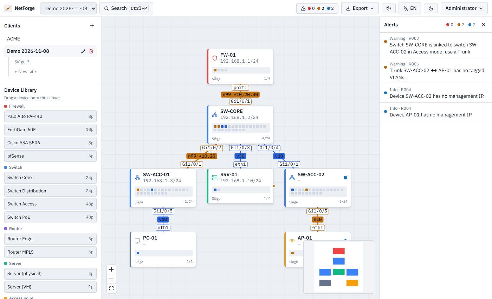

# Tutoriel NetForge — comment ça marche

Ce tutoriel explique **ce que fait chaque étape et pourquoi**. Fais-les dans l'ordre et vérifie le résultat avant de passer à la suivante.



## 1. Comprendre l'architecture (2 minutes)

```
 Navigateur (web)  ┐
 App desktop       ├──►  API (Node/Express)  ──►  PostgreSQL
 App mobile        ┘      /api/v1                 (données + identifiants chiffrés)
```

- **Il n'y a qu'un seul serveur.** Le web, le desktop et le mobile ne stockent rien chez eux : ils lisent et écrivent tous dans la même base. *Pourquoi ?* Une modification faite sur le web apparaît tout de suite sur le téléphone, et il n'y a qu'un endroit à sauvegarder.
- **Le code important est partagé** (`packages/shared`) : validation des erreurs réseau, exports CSV/CLI, traductions. *Pourquoi ?* Les trois applis affichent exactement les mêmes alertes, sans copier-coller de code.
- Le **web** sert à concevoir (glisser-déposer), le **desktop** est le même écran en application installable, le **mobile** sert à consulter et corriger sur le terrain.

## 2. Démarrer le serveur

**Option A — Docker (le plus simple)**

```bash
cp .env.example .env
```
Ouvre `.env` et remplace les valeurs. Pour les deux secrets, génère-les avec :
```bash
openssl rand -base64 32
```
- `JWT_SECRET` signe les connexions : si quelqu'un le connaît, il peut se fabriquer un faux compte.
- `ENCRYPTION_KEY` chiffre les mots de passe des équipements. **Sauvegarde-la** : si tu la perds, ces mots de passe sont illisibles pour toujours.

```bash
docker compose up -d --build
```
✅ Vérification : `http://localhost:3000` affiche la page de connexion. Connecte-toi avec `ADMIN_EMAIL` / `ADMIN_PASSWORD` (le premier admin est créé automatiquement quand la base est vide).

**Option B — sans Docker** (développement) : voir la section « Développement » du README. Il faut un PostgreSQL et les variables `DATABASE_URL`, `JWT_SECRET`, `ENCRYPTION_KEY`.

## 3. Charger le réseau de démo

```bash
npm install && npm run build:shared
npm run seed:demo -- http://localhost:3000 admin@example.com "TonMotDePasse"
```
*Pourquoi ?* Un schéma vide ne montre rien. Ce script crée un petit réseau (pare-feu, switch cœur, 2 switchs d'accès, serveur, PC, borne Wi-Fi) avec **deux erreurs volontaires** pour que tu voies les alertes.

✅ Vérification : choisis « Demo … » dans la liste des clients en haut. Tu dois voir 7 équipements et 2 alertes orange + 2 bleues.

## 4. Utiliser le web

### Ajouter un équipement
Glisse un modèle depuis **Device Library** (à gauche) vers le canvas, ou clique dessus. Chaque équipement est dessiné comme une face avant de baie : un petit carré par port, **bleu = port en Access, orange = port en Trunk, gris = libre**. *Pourquoi ?* On voit d'un coup d'œil quels ports sont pris.

### Tirer un câble
Survole un équipement : une poignée apparaît sur son bord droit. Tire-la vers un autre équipement. La fenêtre **Câble** s'ouvre :

| Champ | Ce que ça veut dire |
|---|---|
| Ports source / destination | Le port physique à chaque bout. Un `•` indique un port déjà utilisé. |
| **Access** | Le port ne transporte **qu'un seul VLAN**, sans étiquette. Pour un PC, une imprimante, un serveur. |
| **Trunk** | Le lien transporte **plusieurs VLANs** en même temps, chacun étiqueté (802.1Q). Pour relier deux switchs ou un switch à un pare-feu. |
| VLAN natif | Le seul VLAN qui passe **sans étiquette** sur un trunk. Il doit être **identique aux deux bouts**, sinon le trafic part dans le mauvais VLAN. |
| VLANs tagués | La liste des VLANs étiquetés, ex. `10,20,30-35`. |

### Modifier un équipement
Double-clic sur l'équipement : 3 onglets.
1. **Identité** : nom, site, modèle, n° de série, rôle, nombre de ports.
2. **Management** : IP de gestion (ex. `192.168.1.254/24`), passerelle, protocoles, identifiant et mot de passe. Le mot de passe est **chiffré** (AES-256-GCM) avant d'entrer en base ; un bouton permet de le révéler (admin/technicien seulement).
3. **VLAN** : le VLAN dédié à l'administration de l'équipement.

### Comprendre les alertes (panneau de droite)
Elles se recalculent à chaque modification, sans rien cliquer. Clique une alerte : le canvas zoome dessus.

| Code | Gravité | Signification | Pourquoi c'est un problème |
|---|---|---|---|
| R001 | 🔴 | Un PC/imprimante en Trunk | Un poste ne sait pas lire les étiquettes VLAN |
| R002 | 🟠 | VLAN natif différent aux deux bouts | Le trafic non étiqueté change de VLAN en route |
| R003 | 🟠 | Switch ↔ switch en Access | Un seul VLAN passera entre les deux : il faut un Trunk |
| R004 | 🔵 | Pas d'IP de management | Tu ne pourras pas administrer l'équipement à distance |
| R005–R012 | | Port identique des deux côtés, trunk sans VLAN, access sans VLAN, port utilisé deux fois, IP dupliquée ou invalide, boucle sur le même équipement… | |

**Exercice** : dans la démo, double-clique le câble `SW-CORE ↔ SW-ACC-02`, passe-le en **Trunk**, mets le VLAN natif à `99` et les VLANs tagués à `10`. L'alerte R003 doit disparaître. Recommence pour `SW-ACC-02 ↔ AP-01` en ajoutant `10` aux VLANs tagués : R006 disparaît.

### Chercher, filtrer
- `Ctrl+P` : recherche par nom, IP, modèle, numéro de port ou client.
- Clique un **site** dans la barre de gauche : les équipements des autres sites sont estompés.

### Exporter (menu Export)
- **CSV** : la matrice de câblage (équipement, port, relié à, mode, VLANs), prête pour Excel.
- **PDF**, **PNG**, **SVG** : le schéma ou le tableau pour un dossier.
- **Config script** : génère les commandes à coller sur un switch Cisco, Huawei ou Arista (VLANs, interfaces, trunks). *Relis toujours avant d'appliquer sur du vrai matériel.*
- **.shmnlt** : fichier JSON portable d'un client (sans les mots de passe), pour sauvegarder ou transférer un schéma. L'import le recrée sur n'importe quel serveur.

### Historique
Le bouton horloge enregistre une **version** (avec une note) et permet de **restaurer**. Avant de restaurer, NetForge sauvegarde automatiquement l'état actuel : tu ne perds rien.

## 5. Les rôles

| Rôle | Peut faire |
|---|---|
| **Admin** | Tout : clients, sites, utilisateurs |
| **Technicien** | Modifier équipements et câbles, voir les mots de passe |
| **Lecteur** | Regarder et exporter, rien modifier |

Les droits sont vérifiés **côté serveur** : cacher un bouton ne suffit pas, la requête est refusée même si quelqu'un la forge. Crée les comptes depuis le menu utilisateur → *Users*.

## 6. L'app desktop

```bash
npm run build -w @netforge/desktop
npm run start -w @netforge/desktop        # lancer
npm run dist -w @netforge/desktop         # fabriquer l'installeur (dossier apps/desktop/release)
```
Au premier lancement, indique l'**URL du serveur** (ex. `http://192.168.1.50:3000`) dans l'écran de connexion. *Pourquoi ?* L'app est une coquille locale : elle a besoin de savoir où est la base. Les exports ouvrent la vraie boîte « Enregistrer sous » du système.

## 7. L'app mobile

```bash
cd apps/mobile && npx expo start
```
Scanne le QR code avec **Expo Go** (iPhone ou Android). Le téléphone et l'ordinateur doivent être sur le même Wi-Fi.

⚠️ Dans l'écran de connexion, mets l'**IP de ton PC** (ex. `http://192.168.1.50:3000`), **jamais `localhost`** : sur le téléphone, `localhost` désigne le téléphone lui-même.

Onglets : **Schéma** (touche un équipement ou un câble pour l'ouvrir), **Équipements** (recherche + ajout), **Câbles** (création/édition), **Alertes**, **Export** (partage via la feuille de partage du téléphone). Tire vers le bas pour actualiser.

## 8. Quand ça ne marche pas

| Symptôme | Cause probable | Solution |
|---|---|---|
| « Cannot reach the server » | Mauvaise URL ou pare-feu | Teste `http://IP:3000/api/v1/health` dans un navigateur |
| Mobile : réseau en erreur | `localhost` utilisé, ou autre Wi-Fi | Utilise l'IP du PC, même réseau |
| Le serveur refuse de démarrer | Variable manquante | Le message liste ce qui manque (`JWT_SECRET`, `ENCRYPTION_KEY`…) |
| Mot de passe d'équipement illisible | `ENCRYPTION_KEY` changée | Remets l'ancienne clé |
| Aucun compte | Base vide sans `ADMIN_EMAIL` | `npm run create-admin -w @netforge/server -- mail "motdepasse"` |
| Session expirée | Jeton JWT périmé | Reconnecte-toi |

## 9. Pour aller plus loin

- Ajouter une règle de validation : `packages/shared/src/validation.ts` (puis les textes dans `i18n/en.ts` et `fr.ts`). Elle apparaît automatiquement dans les trois applis.
- Ajouter un équipement à la bibliothèque : `packages/shared/src/library.ts`.
- Lancer les tests : `npm test -w @netforge/shared` et `npm test -w @netforge/server`.
